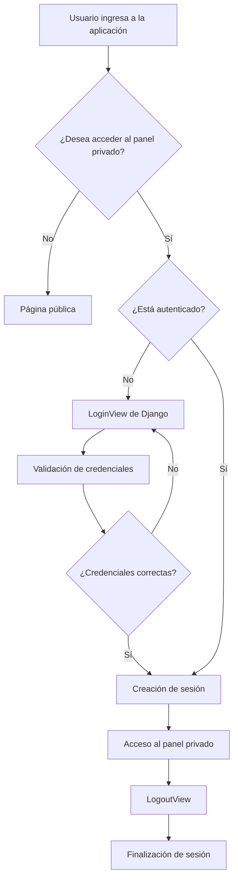

# 🔐 Reutilización del componente de autenticación de Django

## 1. Introducción

En el desarrollo de aplicaciones web es común necesitar funcionalidades de autenticación, como:

- Registro de usuarios.
- Inicio de sesión (Login).
- Cierre de sesión (Logout).
- Cambio y recuperación de contraseñas.
- Administración de usuarios.
- Control de acceso a páginas y recursos privados.

Una alternativa consiste en desarrollar todas estas funcionalidades desde cero. Sin embargo, esto implica mayor esfuerzo de programación y puede introducir vulnerabilidades de seguridad.

Por esta razón, los frameworks modernos proporcionan componentes reutilizables que permiten implementar funcionalidades comunes de manera segura y estandarizada.

En esta actividad estudiaremos cómo reutilizar el **componente de autenticación de Django**, utilizando las funcionalidades que proporciona `django.contrib.auth`.

Documentación oficial:

- Personalización de autenticación: https://docs.djangoproject.com/en/6.1/topics/auth/customizing/
- Uso del sistema de autenticación: https://docs.djangoproject.com/en/6.1/topics/auth/default/

## 2. Objetivos

### Objetivo general

Comprender cómo reutilizar el componente de autenticación proporcionado por Django para implementar mecanismos de identificación, inicio de sesión, cierre de sesión y protección de recursos en una aplicación web.

### Objetivos específicos

- Identificar los componentes de autenticación que proporciona Django.
- Comprender cómo funciona el sistema de autenticación.
- Implementar un inicio y cierre de sesión reutilizando las funcionalidades existentes.
- Proteger páginas que requieren usuarios autenticados.
- Comprender cómo se pueden personalizar los componentes de autenticación.
- Identificar las ventajas de reutilizar componentes frente a desarrollar funcionalidades desde cero.

## 3. ¿Qué significa reutilizar un componente de autenticación?

Reutilizar un componente de autenticación significa aprovechar una funcionalidad que ya ha sido desarrollada e integrada en un framework, evitando implementar nuevamente toda su lógica.

Por ejemplo, cuando desarrollamos una aplicación web necesitamos comprobar que un usuario y su contraseña sean correctos.

Si desarrollamos esta funcionalidad desde cero, tendríamos que implementar:

1. Un modelo para almacenar usuarios.
2. Un mecanismo seguro para almacenar contraseñas.
3. Un formulario de inicio de sesión.
4. Una función para validar las credenciales.
5. Un mecanismo para mantener la sesión del usuario.
6. Un mecanismo para cerrar la sesión.
7. Un mecanismo para proteger las páginas privadas.

Django ya proporciona estos mecanismos mediante su sistema de autenticación.

Por tanto, podemos reutilizar sus funcionalidades y concentrarnos en desarrollar las características propias de nuestra aplicación.

## 4. ¿Qué proporciona Django?

Django incorpora el módulo `django.contrib.auth`, que proporciona diferentes funcionalidades para gestionar la autenticación y autorización.

| Componente | Funcionalidad |
|---|---|
| User | Modelo para representar usuarios. |
| authenticate() | Comprueba las credenciales del usuario. |
| login() | Inicia una sesión autenticada. |
| logout() | Finaliza la sesión. |
| LoginView | Vista reutilizable para iniciar sesión. |
| LogoutView | Vista reutilizable para cerrar sesión. |
| login_required | Protege vistas que requieren autenticación. |
| Permission | Permite gestionar permisos. |
| Group | Permite organizar usuarios en grupos. |
| AbstractUser | Permite extender el modelo de usuario. |

Estos componentes permiten implementar un sistema de autenticación sin desarrollar desde cero los mecanismos fundamentales de seguridad.

## 5. Ejemplo práctico: reutilizar la autenticación de Django

### Escenario

Supongamos que necesitamos desarrollar una aplicación web para administrar estudiantes.

La aplicación tendrá dos tipos de páginas:

- Página pública: cualquier visitante puede acceder.
- Página privada: solamente los usuarios que hayan iniciado sesión pueden acceder.

Para resolver este problema utilizaremos el componente de autenticación de Django.

### 5.1. Crear el proyecto

Primero instalamos Django:

```bash
pip install django
```

Creamos un proyecto:

```bash
django-admin startproject proyecto_auth
cd proyecto_auth
```

Creamos una aplicación:

```bash
python manage.py startapp estudiantes
```

La estructura será similar a la siguiente:

```text
proyecto_auth/
│
├── manage.py
│
├── proyecto_auth/
│   ├── settings.py
│   ├── urls.py
│   └── ...
│
└── estudiantes/
    ├── views.py
    ├── urls.py
    ├── models.py
    └── ...
```

### 5.2. Configurar la aplicación

En `proyecto_auth/settings.py`, verificamos que estén habilitados los siguientes componentes:

```python
INSTALLED_APPS = [
    'django.contrib.admin',
    'django.contrib.auth',
    'django.contrib.contenttypes',
    'django.contrib.sessions',
    'django.contrib.messages',
    'django.contrib.staticfiles',

    'estudiantes',
]
```

También verificamos que estén habilitados los middleware relacionados con sesiones y autenticación:

```python
MIDDLEWARE = [
    'django.middleware.security.SecurityMiddleware',
    'django.contrib.sessions.middleware.SessionMiddleware',
    'django.middleware.common.CommonMiddleware',
    'django.middleware.csrf.CsrfViewMiddleware',
    'django.contrib.auth.middleware.AuthenticationMiddleware',
    'django.contrib.messages.middleware.MessageMiddleware',
]
```

Configuramos las rutas de autenticación:

```python
LOGIN_URL = '/accounts/login/'
LOGIN_REDIRECT_URL = '/privado/'
LOGOUT_REDIRECT_URL = '/accounts/login/'
```

**¿Qué estamos haciendo?**

Estamos reutilizando los componentes de autenticación que Django ya proporciona. No estamos creando un sistema propio para almacenar contraseñas ni para gestionar sesiones.

### 5.3. Crear un usuario

Django proporciona un comando para crear usuarios administradores:

```bash
python manage.py migrate
python manage.py createsuperuser
```

El sistema solicitará:

```text
Username: admin
Email address: admin@example.com
Password:
Password (again):
```

También podemos crear usuarios normales desde la consola:

```bash
python manage.py shell
```

```python
from django.contrib.auth.models import User

User.objects.create_user(
    username='estudiante',
    email='estudiante@example.com',
    password='Estudiante123!'
)
```

**Importante:** Utilizamos `create_user()` porque Django se encarga de aplicar el mecanismo de hash correspondiente a la contraseña. Nunca debemos almacenar contraseñas directamente como texto plano.

### 5.4. Reutilizar el componente LoginView

Ahora implementaremos el inicio de sesión.

En `proyecto_auth/urls.py`:

```python
from django.contrib import admin
from django.urls import path, include

urlpatterns = [
    path('admin/', admin.site.urls),
    path('accounts/', include('django.contrib.auth.urls')),
    path('', include('estudiantes.urls')),
]
```

Con esta configuración Django incorpora automáticamente varias rutas de autenticación, entre ellas:

| Ruta | Funcionalidad |
|---|---|
| `/accounts/login/` | Iniciar sesión. |
| `/accounts/logout/` | Cerrar sesión. |
| `/accounts/password_change/` | Cambiar contraseña. |
| `/accounts/password_reset/` | Solicitar recuperación de contraseña. |

Para personalizar la pantalla de inicio de sesión creamos:

```text
templates/
└── registration/
    └── login.html
```

En `login.html`:

```html
<h2>Iniciar sesión</h2>

<form method="post">
    

    {{ form.as_p }}

    <button type="submit">
        Ingresar
    </button>
</form>
```

Configuramos el directorio de plantillas en `settings.py`:

```python
TEMPLATES = [
    {
        'BACKEND': 'django.template.backends.django.DjangoTemplates',
        'DIRS': [BASE_DIR / 'templates'],
        'APP_DIRS': True,
        'OPTIONS': {
            'context_processors': [
                'django.template.context_processors.debug',
                'django.template.context_processors.request',
                'django.contrib.auth.context_processors.auth',
                'django.contrib.messages.context_processors.messages',
            ],
        },
    },
]
```

**¿Qué estamos reutilizando?**

No hemos programado una función para validar el usuario y la contraseña. Django utiliza su `LoginView`, su formulario de autenticación y sus mecanismos de validación.

Nosotros solamente hemos personalizado la interfaz gráfica.

### 5.5. Crear una página privada

Ahora necesitamos una página a la que solamente puedan acceder los usuarios autenticados.

En `estudiantes/views.py`:

```python
from django.shortcuts import render
from django.contrib.auth.decorators import login_required

def inicio(request):
    return render(request, 'inicio.html')


@login_required
def panel_privado(request):
    return render(request, 'privado.html')
```

Creamos las rutas en `estudiantes/urls.py`:

```python
from django.urls import path
from . import views

urlpatterns = [
    path('', views.inicio, name='inicio'),
    path('privado/', views.panel_privado, name='privado'),
]
```

Creamos `templates/inicio.html`:

```html
<h1>Bienvenido a nuestra aplicación</h1>

<p>Esta es una página pública.</p>

<a href="/accounts/login/">
    Iniciar sesión
</a>
```

Creamos `templates/privado.html`:

```html
<h1>Panel privado</h1>

<p>
    Bienvenido {{ request.user.username }}
</p>

<form method="post" action="/accounts/logout/">
    

    <button type="submit">
        Cerrar sesión
    </button>
</form>
```

**¿Qué estamos reutilizando?**

Estamos utilizando el decorador `@login_required` de Django.

Este componente comprueba si el usuario ha iniciado sesión. Si no está autenticado, lo redirige a la página de inicio de sesión.

Si está autenticado, permite acceder al contenido privado.

Además, utilizamos `LogoutView` para finalizar la sesión mediante una solicitud POST protegida con CSRF.

### 5.6. Ejecutar el proyecto

Iniciamos el servidor:

```bash
python manage.py runserver
```

Probamos las siguientes direcciones:

| URL | Resultado esperado |
|---|---|
| http://127.0.0.1:8000/ | Acceso público. |
| http://127.0.0.1:8000/accounts/login/ | Formulario de autenticación. |
| http://127.0.0.1:8000/privado/ | Acceso restringido. |
| http://127.0.0.1:8000/accounts/logout/ | Cierre de sesión mediante POST. |

## 6. Comprendiendo el funcionamiento

El siguiente diagrama representa el funcionamiento básico de nuestro sistema:



## 7. ¿Qué pasaría si desarrolláramos la autenticación desde cero?

Comparemos las dos alternativas:

| Característica | Desarrollo desde cero | Reutilización de Django |
|---|---|---|
| Validación de credenciales | Implementación propia. | authenticate() y LoginView. |
| Almacenamiento de contraseñas | Implementación propia. | Hash seguro integrado. |
| Gestión de sesiones | Implementación propia. | Sistema de sesiones de Django. |
| Inicio de sesión | Desarrollo propio. | LoginView. |
| Cierre de sesión | Desarrollo propio. | LogoutView. |
| Protección de páginas | Desarrollo propio. | login_required. |
| Permisos | Desarrollo propio. | Sistema de permisos integrado. |
| Mantenimiento | Mayor responsabilidad. | Se aprovechan las actualizaciones del framework. |

**Conclusión:** Reutilizar un componente existente permite reducir el código que debemos desarrollar, aprovechar mecanismos de seguridad probados y concentrarnos en la lógica de negocio de nuestra aplicación.

Esto no significa que la aplicación sea automáticamente segura. También debemos configurar correctamente las sesiones, HTTPS, cookies, permisos, protección CSRF y mecanismos contra ataques de fuerza bruta.

## 8. Actividades que deben realizar los estudiantes

A partir del ejemplo desarrollado, deberán realizar las siguientes actividades:

### Actividad 1. Comprender el componente

Investigar y explicar:

1. ¿Qué es `django.contrib.auth`?
2. ¿Qué funcionalidades proporciona?
3. ¿Qué diferencia existe entre autenticación y autorización?
4. ¿Qué es `LoginView`?
5. ¿Qué es `LogoutView`?
6. ¿Qué función cumple `login_required`?
7. ¿Cómo almacena Django las contraseñas?
8. ¿Cómo funcionan las sesiones?

### Actividad 2. Implementación práctica

Implementar una aplicación web que reutilice el sistema de autenticación de Django.

La aplicación deberá tener:

- Una página pública.
- Una página de inicio de sesión.
- Una página privada.
- Un mecanismo para cerrar sesión.
- Al menos dos usuarios registrados.
- Protección de las páginas privadas mediante `login_required`.

### Actividad 3. Personalización

Investigar cómo personalizar el componente de autenticación.

Implementar al menos una de las siguientes modificaciones:

- Personalizar el modelo de usuario utilizando `AbstractUser`.
- Utilizar el correo electrónico como identificador.
- Agregar información adicional al perfil del usuario.
- Implementar grupos y permisos.
- Personalizar el formulario de inicio de sesión.

### Actividad 4. Pruebas de seguridad

Realizar las siguientes pruebas:

1. Intentar ingresar al panel privado sin autenticarse.
2. Intentar iniciar sesión con credenciales incorrectas.
3. Iniciar sesión con un usuario válido.
4. Comprobar que el usuario autenticado puede acceder al panel privado.
5. Cerrar sesión.
6. Intentar acceder nuevamente al panel privado.
7. Comprobar que el sistema redirige al formulario de inicio de sesión.

Documentar los resultados mediante capturas de pantalla.

### Actividad 5. Análisis crítico

Responder:

- ¿Qué ventajas encontramos al reutilizar el componente de autenticación?
- ¿Qué problemas de seguridad evitamos al no implementar nuestro propio mecanismo de contraseñas?
- ¿Qué funcionalidades adicionales podríamos incorporar?
- ¿En qué situaciones sería necesario personalizar el sistema de autenticación?
- ¿Qué responsabilidades de seguridad siguen siendo responsabilidad del desarrollador?

## 9. Entregables

Cada estudiante o grupo deberá entregar:

- [ ] Código fuente de la aplicación.
- [ ] README con instrucciones de instalación y ejecución.
- [ ] Explicación de los componentes reutilizados.
- [ ] Evidencias de las pruebas de autenticación.
- [ ] Evidencias de las pruebas de acceso a páginas privadas.
- [ ] Una personalización del sistema de autenticación.
- [ ] Respuestas del análisis crítico.

## 10. Criterios de evaluación

| Criterio | Porcentaje |
|---|---:|
| Comprensión del sistema de autenticación de Django | 15 % |
| Implementación de Login y Logout | 20 % |
| Protección de páginas privadas | 15 % |
| Personalización del componente | 20 % |
| Pruebas funcionales y de seguridad | 20 % |
| Documentación y conclusiones | 10 % |
| **Total** | **100 %** |

## 11. Referencias

- Django 6.1 - Customizing authentication: https://docs.djangoproject.com/en/6.1/topics/auth/customizing/
- Django 6.1 - Using the authentication system: https://docs.djangoproject.com/en/6.1/topics/auth/default/
- Django 6.1 - Authentication views: https://docs.djangoproject.com/en/6.1/topics/auth/default/#all-authentication-views
- Django 6.1 - Password management: https://docs.djangoproject.com/en/6.1/topics/auth/passwords/
- OWASP Authentication Cheat Sheet: https://cheatsheetseries.owasp.org/cheatsheets/Authentication_Cheat_Sheet.html

---

## 12. Reflexión final

El desarrollo de software moderno requiere aprovechar componentes, bibliotecas y frameworks que resuelvan problemas comunes.

La autenticación es una funcionalidad crítica para cualquier aplicación que gestione usuarios. Por ello, en lugar de desarrollar mecanismos propios de almacenamiento de contraseñas, validación de credenciales y gestión de sesiones, podemos reutilizar componentes que proporcionan los frameworks.

**El objetivo es aprender a reutilizar, configurar, extender y proteger componentes existentes, comprendiendo qué hacen internamente y qué responsabilidades siguen correspondiendo al desarrollador.**
